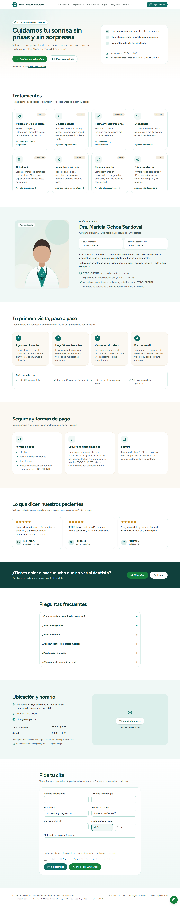

# Dental / medical practice website

One-page site for dentists, doctors and therapists: treatments with "book via WhatsApp" links, specialist profile with license number, hours, appointment form and privacy notice.

**Live demo:** https://christianjair27.github.io/astro-dental-clinic/
Demo content: Brisa Dental Querétaro, a fictional dental clinic. Names, numbers and testimonials are placeholders.

| Desktop | Mobile |
|---|---|
|  |  |

## Highlights

- **Fast:** static HTML from Astro, CSS inlined, no client framework. Lighthouse mobile (measured 26 Oct 2026): **100 · 100 · 100 · 100** (Performance · Accessibility · Best Practices · SEO).
- **Local SEO built in:** title, description, canonical, Open Graph, JSON-LD (business + FAQPage), sitemap, robots and a real 404.
- **Leads that convert:** WhatsApp links with a pre-filled message, click-to-call, and a lead form (PHP endpoint with honeypot and rate limiting, for shared hosting like Hostinger).
- **Measurable:** GA4 events `generate_lead`, `whatsapp_click`, `phone_click`, `email_click`.
- **One file to customize:** all copy and contact data live in `src/config/site.ts` (look for `TODO-CLIENTE`).
- **Accessible:** semantic sections, labels, focus states, AA contrast; the map loads only on click.

## Run it

```bash
npm install
npm run dev        # http://localhost:4321
npm run build      # static site in dist/
npm test           # Playwright smoke tests (desktop + mobile)
```

The contact form posts to `/api/lead.php`, so it needs PHP hosting; on the GitHub Pages demo it falls back to a WhatsApp link. A detailed guide in Spanish is in [docs/guia-es.md](docs/guia-es.md).

## Stack

Astro 5 · Tailwind CSS 4 · TypeScript · Playwright · PHP (form endpoint)

---

Template by [Revolution505](https://revolution505.com), a web studio in Querétaro, Mexico. Need a site like this for your business? [Get in touch](https://revolution505.com).
